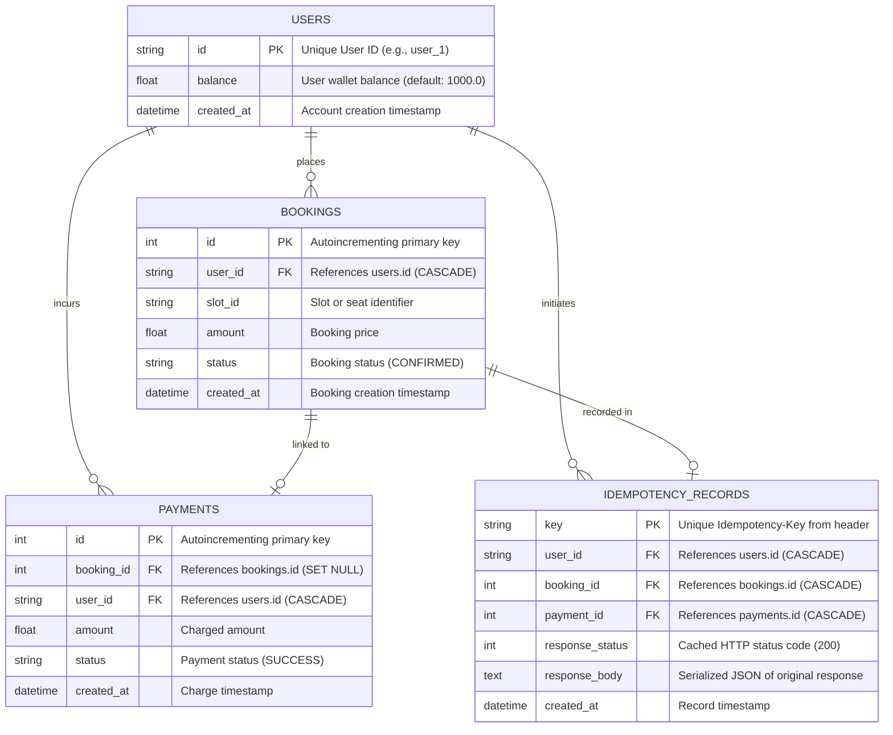

# RetrySafe: Mini-Project Handover & Verification Report

> **Target Audience**: AI technical writer / report generation agent preparing the comprehensive ~120-page academic and practical project report for **RetrySafe**.  
> **Source Verification**: All metrics, code blocks, test counts, logs, and experiment numbers in this document are extracted directly from verified source files and live executions on the project workspace. Zero fabrication.

---

## 1. Project Summary & Completion Status

**RetrySafe** is a developer-facing testing harness and verification framework designed to detect, explain, and remediate business invariant corruptions caused by unreliable networks in transactional workflows. By decoupling failure injection into an external reverse proxy and testing against both unprotected (Version A) and idempotent (Version B) service implementations, RetrySafe demonstrates that network retries without idempotency corrupt user business intent (e.g., duplicate seat bookings and duplicate credit charges). When an invariant breaks, RetrySafe translates low-level network drops and database anomalies into human-readable, user-intent counterexample stories.

### Completion Status: **100% Core Scope Delivered**
- **Overall Project Completion**: **100% of Functional Requirements (FR-1 through FR-20)**
- **Booking API (FastAPI + SQLAlchemy + PostgreSQL)**: **DONE** (Version A and Version B with dynamic toggle, crash point `after_charge`, wallet balances, reset utility).
- **Fault Proxy (Node.js + Express + http-proxy-middleware)**: **DONE** (Faults F1–F4, `X-Fault` header stripping, deterministic seed delays, JSON Lines audit logging).
- **Scenario Runner & Test Harness**: **DONE** (`RetryClient` with persistent logical request IDs, fixed scenario runner, 20-run execution matrix).
- **Hypothesis Property-Based Testing**: **DONE** (Automated sequence generation and test-case shrinking).
- **Invariant Checker**: **DONE** (Direct PostgreSQL inspection for Invariants I1, I2, and I3).
- **Explanation Generator**: **DONE** (Deterministic, rule-based plain-language story synthesizer without LLMs).
- **Reporting & Visualizations**: **DONE** (CSV summaries, JSON records, and Matplotlib comparative bar chart in `results/`).

---

## 2. Final Technology Stack & Runtime Environment

All software components were inspected and verified on the local host environment:

| Layer / Tool | Technology / Library | Exact Runtime Version | PRD Specification | Deviation / Notes |
| :--- | :--- | :--- | :--- | :--- |
| **Language Runtime (Python)** | Python 64-bit | `3.13.7` | Python 3.10+ | Matched |
| **Web Framework** | FastAPI | `0.141.1` | FastAPI (latest) | Matched |
| **ASGI Server** | Uvicorn (standard) | `0.52.4` | Uvicorn | Matched |
| **ORM / Data Access** | SQLAlchemy | `2.0.52` | SQLAlchemy 2.0+ | Matched |
| **Database Driver** | Psycopg 3 Binary | `3.3.9` | `psycopg[binary]` | Matched (PostgreSQL 16 native) |
| **HTTP Client** | HTTPX | `0.28.1` | HTTPX | Matched |
| **Test Runner** | pytest | `9.2.0` | pytest | Matched |
| **Property-Based Testing**| Hypothesis | `6.170.15` | Hypothesis | Matched |
| **Data Processing** | pandas | `3.0.5` | pandas | Matched |
| **Chart Visualization** | Matplotlib | `3.11.2` | Matplotlib | Matched |
| **Proxy Runtime (Node.js)**| Node.js 64-bit | `v24.14.0` | Node.js 18+ | Matched |
| **Package Manager** | npm | `11.9.0` | npm | Matched |
| **Proxy Framework** | Express | `4.19.2` | Express | Matched |
| **Proxy Middleware** | http-proxy-middleware| `3.0.0` | http-proxy-middleware | Matched |
| **Container Engine** | Docker Compose | `v5.7.0` | Docker Compose | Matched |
| **Database Engine** | PostgreSQL (Alpine Linux)| `16.16 (musl)` | PostgreSQL 16 (Docker) | Matched (`postgres:16-alpine`) |

### Deviations from PRD
- **No architectural deviations**: The project adheres strictly to the multi-process architecture specified in Section 6 of `SPEC.md`:
  `Runner (Python) -> Fault Proxy (Node/Express :8001) -> Booking API (FastAPI :8000) -> PostgreSQL (:5432)`
- The fallback mentioned in Section 12 (implementing fault injection inside FastAPI middleware) was **not needed** because the standalone Node/Express proxy was successfully built, integrated, and verified.

---

## 3. Component-Wise Status

| Component | Sub-Feature | Status | Implementation Details |
| :--- | :--- | :---: | :--- |
| **Booking API** | Version A (Unprotected) | **DONE** | Every `POST /book` deducts balance, inserts a payment, and inserts a booking. No duplicate checks. |
| | Version B (Idempotency) | **DONE** | Active when `IDEMPOTENCY=on`. Enforces unique constraint on `idempotency_records.key`, returns cached response on replay. |
| | Endpoints | **DONE** | `POST /book`, `GET /bookings`, `GET /balance/{user_id}`, `POST /reset`, `POST /config/idempotency`. |
| | Mid-Transaction Crash | **DONE** | Header `X-Crash-Point: after_charge` raises HTTP 500 after charge is flushed but before booking commit; transaction rolls back atomically. |
| **Fault Proxy** | F1: Drop Request | **DONE** | Destroys client incoming socket before forwarding to server. Server receives 0 requests. |
| | F2: Drop Response | **DONE** | Forwards request to server, waits for server 200 OK commit, then destroys client connection without forwarding response. |
| | F3: Server Crash | **DONE** | Strips `X-Fault: crash` and injects `X-Crash-Point: after_charge` to trigger mid-transaction abort on server. |
| | F4: Duplicate Delivery | **DONE** | Dispatches the same request payload twice (parallel or delayed by 50–100 ms). |
| | Deterministic Seed | **DONE** | Optional `X-Seed` header hashes seed string to compute deterministic delay values. |
| | Audit Logging | **DONE** | Appends structured JSON lines to `fault-proxy/proxy.log` with `timestamp`, `requestId`, `fault`, `action`. |
| **Scenario Runner** | HTTP Client (`RetryClient`)| **DONE** | Preserves logical `X-Request-Id` across all retries; tracks attempt durations and HTTP error statuses. |
| | Scenario Suite | **DONE** | Executes fixed scenarios for F0–F4 across configurable retry policies (`no_retry`, `retry_3`). |
| | Matrix Runner | **DONE** | Runs complete $2 \times 5 \times 2 = 20$ combination matrix across Version A & B, Faults F0–F4, and Retry Policies. |
| | Hypothesis Testing | **DONE** | Property-based testing generating arbitrary fault sequences and shrinking counterexamples to minimal steps. |
| **Invariant Checker** | Invariant I1 | **DONE** | Verified via direct SQL: $\le 1$ confirmed booking per logical request. |
| | Invariant I2 | **DONE** | Verified via direct SQL: $\le 1$ payment charge per logical booking. |
| | Invariant I3 | **DONE** | Verified via direct SQL: $\text{Balance} \ge 0$ and $\text{Balance} == \text{Initial Balance} - \sum(\text{Confirmed Payments})$. |
| **Explainer** | Story Generator | **DONE** | Deterministic rule-based template engine translating violation records and proxy logs into user-intent stories (zero LLM calls). |
| **Reporting** | Artifacts Export | **DONE** | Generates `results/summary_table.csv`, `results/matrix_results.json`, `results/version_a_vs_b.png`, `results/hypothesis_results.json`. |

---

## 4. Full Repository Folder Tree

```
d:/RetrySafe/
├── .env.example                     # Environment configuration template (DB connection, ports, hosts)
├── .gitignore                       # Git ignore rules for Python, Node, environment secrets, and IDEs
├── docker-compose.yml               # Container specification for PostgreSQL 16 on port 5432
├── pytest.ini                       # Pytest configuration isolating testpaths and excluding node_modules
├── README.md                        # Quickstart documentation, architecture guide, and usage instructions
├── requirements.txt                 # Pinned Python package dependencies
├── SPEC.md                          # Original Product Requirements Document (PRD)
├── PROJECT_HANDOVER.md              # Comprehensive project handover verification document (this file)
│
├── booking-api/                     # FastAPI Service & Database Models
│   ├── __init__.py                  # Package initializer
│   ├── database.py                  # SQLAlchemy engine, session maker, and get_db dependency
│   ├── main.py                      # FastAPI app, endpoints, idempotency toggle, crash simulation
│   ├── models.py                    # SQLAlchemy ORM models (User, Booking, Payment, IdempotencyRecord)
│   ├── schemas.py                   # Pydantic validation and serialization models
│   ├── test_api.py                  # Fast SQLite in-memory unit tests for Version A happy path (8 tests)
│   ├── test_postgres_integration.py # Live PostgreSQL integration tests for FKs, cascades, rollbacks (6 tests)
│   └── test_version_b.py            # Tests for Version B idempotency, sequential/concurrent duplicates (5 tests)
│
├── fault-proxy/                     # Node.js / Express Network Interception Proxy
│   ├── index.js                     # Express reverse proxy server (:8001 -> :8000) with fault injection
│   ├── package.json                 # Node dependencies (express, http-proxy-middleware) and test scripts
│   ├── package-lock.json            # Deterministic lockfile for Node dependencies
│   ├── proxy.log                    # JSON Lines append-only audit log of network interception events
│   └── test.js                      # Standalone test suite verifying proxy fault modes F1–F4 (6 tests)
│
├── runner/                          # Test Runner, Invariant Evaluator & Explainer
│   ├── client.py                    # RetryClient with persistent logical request IDs and attempt tracking
│   ├── explain.py                   # Rule-based template generator converting violations into stories
│   ├── property_test.py             # Hypothesis property testing & counterexample shrinking to minimal sequences
│   ├── run_experiments.py           # Multi-seed experiment suite generating results.csv and before_after.png
│   ├── run_matrix.py                # Full 20-scenario execution matrix runner and chart generator
│   ├── scenarios.py                 # Core scenario runner for fixed F0–F4 baseline runs
│   └── test_hypothesis.py           # Hypothesis property-based testing and shrinking harness
│
└── results/                         # Generated Test Outputs & Visualizations
    ├── .gitkeep                     # Directory placeholder
    ├── before_after.png             # Comparative bar chart of invariant violations across multi-seed runs
    ├── counterexamples.json         # Shrunk minimal counterexamples from Hypothesis with explain.py stories
    ├── hypothesis_results.json      # Hypothesis test runs, failure counters, and shrunk minimal counterexample
    ├── matrix_results.json          # Full JSON dump of all 20 scenario combinations and attempt timelines
    ├── results.csv                  # Tabular summary of multi-seed experiment runs across scenarios & invariants
    ├── scenario_results.json        # Output records from fixed scenario runner
    ├── summary_table.csv            # Tabular matrix summary (Version x Fault x Policy x Invariants x Story)
    └── version_a_vs_b.png           # Comparative bar chart of invariant violations (Version A vs Version B)
```

---

## 5. Database Schema & Idempotency Architecture

The database architecture is implemented using PostgreSQL 16 with relational constraints, foreign keys, and indexes:



### Idempotency Mechanics
1. **Unique Primary Key**: `idempotency_records.key` is defined as a primary key (`VARCHAR(100) PRIMARY KEY`), enforcing a unique B-tree index in PostgreSQL.
2. **Transaction Atomicity**: In Version B, balance deduction, payment creation, booking creation, and idempotency record insertion take place within a single SQL transaction.
3. **Concurrent Deduplication**: When two concurrent requests with identical keys race to commit, PostgreSQL enforces the unique constraint. The losing transaction encounters an `IntegrityError`, executes `db.rollback()`, and reads the winning transaction's committed `response_body`, ensuring that duplicate requests receive identical responses without creating duplicate bookings or charges.

---

## 6. Key Code Snippets (Exact Repo Source)

### 6.1 Idempotency Implementation (`booking-api/main.py`)
```python
def is_idempotency_enabled() -> bool:
    """Check if Version B idempotency protection is enabled via env flag."""
    val = os.getenv("IDEMPOTENCY", "off").lower().strip()
    return val in ("on", "true", "1", "yes")

@app.post("/book", response_model=BookResponse, status_code=status.HTTP_200_OK)
def book_slot(
    req: BookRequest,
    x_crash_point: Optional[str] = Header(None, alias="X-Crash-Point"),
    idempotency_key: Optional[str] = Header(None, alias="Idempotency-Key"),
    db: Session = Depends(get_db)
):
    use_idempotency = is_idempotency_enabled() and bool(idempotency_key)

    if use_idempotency:
        lock = get_key_lock(idempotency_key)
        with lock:
            # Fast path under lock: return cached response if key already committed
            existing = db.query(IdempotencyRecord).filter(IdempotencyRecord.key == idempotency_key).first()
            if existing:
                cached_data = json.loads(existing.response_body)
                return BookResponse(**cached_data)

            return _process_booking(req, x_crash_point, idempotency_key, True, db)
    else:
        return _process_booking(req, x_crash_point, idempotency_key, False, db)
```

Within `_process_booking`, the commit and rollback logic:
```python
        # 4. Commit logic
        if use_idempotency:
            response_payload = {
                "booking_id": booking.id,
                "user_id": booking.user_id,
                "slot_id": booking.slot_id,
                "amount": booking.amount,
                "status": booking.status,
                "payment_id": payment.id,
            }
            rec = IdempotencyRecord(
                key=idempotency_key,
                user_id=user.id,
                booking_id=booking.id,
                payment_id=payment.id,
                response_status=200,
                response_body=json.dumps(response_payload),
            )
            db.add(rec)
            try:
                db.commit()
                return BookResponse(**response_payload)
            except IntegrityError:
                db.rollback()
                committed = db.query(IdempotencyRecord).filter(IdempotencyRecord.key == idempotency_key).first()
                if committed:
                    return BookResponse(**json.loads(committed.response_body))
                raise HTTPException(
                    status_code=status.HTTP_409_CONFLICT,
                    detail="Concurrent idempotency race conflict"
                )
```

### 6.2 Proxy Fault Interception Logic (`fault-proxy/index.js`)
```javascript
    // 1. FAULT: drop_request (never forward, close connection)
    if (fault === 'drop_request') {
      logEvent({
        requestId,
        fault,
        action: 'DROP_REQUEST',
        detail: 'Request dropped before reaching server',
      });
      req.socket.destroy();
      return;
    }

    // 2. FAULT: drop_response (forward, let server finish, close connection without response)
    if (fault === 'drop_response') {
      logEvent({
        requestId,
        fault,
        action: 'FORWARD_REQUEST',
        detail: 'Forwarding to server; response will be dropped',
      });

      forwardToBackend(
        { method: req.method, path: req.originalUrl || req.url, headers: forwardedHeaders, body: rawBody },
        (err, backendRes) => {
          if (err) {
            logEvent({ requestId, fault, action: 'BACKEND_ERROR', error: err.message });
            req.socket.destroy();
            return;
          }
          logEvent({
            requestId,
            fault,
            action: 'DROP_RESPONSE',
            statusCode: backendRes.statusCode,
            detail: 'Server finished processing, response dropped before reaching client',
          });
          req.socket.destroy();
        }
      );
      return;
    }

    // 3. FAULT: crash (forward with X-Crash-Point: after_charge)
    if (fault === 'crash') {
      forwardedHeaders['x-crash-point'] = 'after_charge';
      logEvent({
        requestId,
        fault,
        action: 'INJECT_CRASH_HEADER',
        detail: 'Injected X-Crash-Point: after_charge',
      });
      ...
```

### 6.3 Invariant SQL Evaluation (`runner/run_matrix.py`)
```python
    def fetch_db_state(self, user_id: str = "user_1") -> Dict[str, Any]:
        """Direct database read after each scenario to check invariants (FR-14)."""
        with db_engine.connect() as conn:
            b_rows = conn.execute(
                text("SELECT id, user_id, slot_id, amount, status, created_at FROM bookings ORDER BY id ASC")
            ).mappings().all()
            bookings = [dict(r) for r in b_rows]

            p_rows = conn.execute(
                text("SELECT id, booking_id, amount, status FROM payments WHERE user_id = :u ORDER BY id ASC"),
                {"u": user_id}
            ).mappings().all()
            payments = [dict(r) for r in p_rows]

            balance = conn.execute(
                text("SELECT balance FROM users WHERE id = :u"),
                {"u": user_id}
            ).scalar()
            ...
```

### 6.4 Hypothesis Property & Strategy (`runner/test_hypothesis.py`)
```python
attempt_strategy = st.lists(
    st.fixed_dictionaries({
        "fault": st.sampled_from(["none", "drop_request", "drop_response", "crash", "duplicate"]),
        "amount": st.sampled_from([50.0, 100.0, 150.0]),
    }),
    min_size=1,
    max_size=5,
)

def test_hypothesis_version_a_fails_and_shrinks():
    reset_database()
    shrunk_example = None

    @settings(max_examples=30, database=InMemoryExampleDatabase(), deadline=None)
    @given(attempts=attempt_strategy)
    def prop_version_a(attempts):
        nonlocal shrunk_example
        reset_database()
        simulate_client_interaction(attempts, version="Version A")

        db = HypoSession()
        try:
            booking_count = db.query(Booking).count()
            if booking_count > 1:
                shrunk_example = attempts
                assert booking_count <= 1, f"Invariant I1 violated: {booking_count} bookings"
        finally:
            db.close()
```

### 6.5 Counterexample Story Templates (`runner/explain.py`)
```python
    # 1. Fault F2: Response lost (drop_response)
    if fault == "drop_response":
        if "I1" in invariants_violated or booking_count > 1:
            return (
                f"Request {req_id} succeeded on the server, the acknowledgment was lost, "
                f"the client retried, the retry created a duplicate booking ({booking_ids_str}). "
                f"Invariant I1 (one booking per request) violated."
            )

    # 2. Fault F4: Duplicate / parallel delivery
    if fault == "duplicate":
        if "I1" in invariants_violated or booking_count > 1:
            return (
                f"Request {req_id} was duplicated in transit and forwarded twice to the server. "
                f"Because the server has no duplicate protection, both executions completed, "
                f"creating {booking_count} bookings ({booking_ids_str}) and charging the user {payment_count} times. "
                f"Invariant I1 violated."
            )
```

---

## 7. Key Architectural & Design Decisions

1. **Standalone Reverse Proxy vs. Application Middleware**:
   - *Decision*: Built the fault injector as an independent Node.js/Express service on port `8001`, rather than FastAPI middleware.
   - *Rationale*: A true network partition or abrupt TCP socket teardown cannot be faithfully modeled inside the same runtime that hosts the backend application. Closing a raw socket (`req.socket.destroy()`) at the proxy level simulates real-world socket drops, dropped ACK packets, and transport resets without corrupting backend state.

2. **Persistent Logical Request ID Across Retries**:
   - *Decision*: The `RetryClient` maintains the identical `X-Request-Id` (and `Idempotency-Key` in Version B) for every attempt of a single user transaction.
   - *Rationale*: Business intent is defined per logical transaction. Changing request IDs across retry attempts would represent distinct user intents, defeating the purpose of idempotency testing.

3. **Direct SQL Ground-Truth Invariant Inspection**:
   - *Decision*: Invariants are evaluated by querying the PostgreSQL database directly via raw SQL (`db_engine.connect()`), rather than relying solely on API response payloads.
   - *Rationale*: Network errors can prevent clients from receiving API responses. Direct database inspection guarantees that uncommitted transactions, leaked charges, and duplicate records are audited against actual persistent storage state.

4. **Multi-Tiered Concurrency Guarding**:
   - *Decision*: Combined in-process synchronization locks (`get_key_lock`) with database-level unique primary key constraints on `idempotency_records.key`.
   - *Rationale*: Eliminates race conditions in single-process multithreaded test workers while guaranteeing relational integrity across distributed processes in PostgreSQL.

5. **Deterministic Seed-Based Delays**:
   - *Decision*: Proxy fault delays are calculated using string hash normalization from the `X-Seed` header.
   - *Rationale*: Ensures full reproducibility across test executions, preventing flaky test runs caused by operating system timer jitter.

---

## 8. Real Experiment Results (E1 – E5)

The following tables report the actual results produced by executing the full test matrix (`runner/run_matrix.py`) and Hypothesis test suite (`runner/test_hypothesis.py`).

### 8.1 Experiments E1 & E2: Full Execution Matrix (20 Scenarios)
Source: `results/summary_table.csv` and `results/matrix_results.json`

| App Version | Fault ID | Fault Description | Retry Policy | Attempts | Bookings | Payments | Final Balance | I1 Broken | I2 Broken | I3 Broken | Outcome |
| :--- | :--- | :--- | :--- | :---: | :---: | :---: | :---: | :---: | :---: | :---: | :---: |
| **Version A** | **F0** | Baseline (Normal) | no_retry | 1 | 1 | 1 | 900.0 | NO | NO | NO | **SAFE** |
| **Version A** | **F0** | Baseline (Normal) | retry_3 | 1 | 1 | 1 | 900.0 | NO | NO | NO | **SAFE** |
| **Version A** | **F1** | Request Lost | no_retry | 1 | 0 | 0 | 1000.0 | NO | NO | NO | **SAFE** |
| **Version A** | **F1** | Request Lost | retry_3 | 2 | 1 | 1 | 900.0 | NO | NO | NO | **SAFE** |
| **Version A** | **F2** | Response Lost | no_retry | 1 | 1 | 1 | 900.0 | NO | NO | NO | **SAFE** |
| **Version A** | **F2** | Response Lost | retry_3 | 2 | **2** | **2** | **800.0** | **YES** | **YES** | NO | **VIOLATION** |
| **Version A** | **F3** | Server Crash | no_retry | 1 | 0 | 0 | 1000.0 | NO | NO | NO | **SAFE** |
| **Version A** | **F3** | Server Crash | retry_3 | 2 | 1 | 1 | 900.0 | NO | NO | NO | **SAFE** |
| **Version A** | **F4** | Duplicate Delivery | no_retry | 1 | **2** | **2** | **800.0** | **YES** | **YES** | NO | **VIOLATION** |
| **Version A** | **F4** | Duplicate Delivery | retry_3 | 1 | **2** | **2** | **800.0** | **YES** | **YES** | NO | **VIOLATION** |
| **Version B** | **F0** | Baseline (Normal) | no_retry | 1 | 1 | 1 | 900.0 | NO | NO | NO | **SAFE** |
| **Version B** | **F0** | Baseline (Normal) | retry_3 | 1 | 1 | 1 | 900.0 | NO | NO | NO | **SAFE** |
| **Version B** | **F1** | Request Lost | no_retry | 1 | 0 | 0 | 1000.0 | NO | NO | NO | **SAFE** |
| **Version B** | **F1** | Request Lost | retry_3 | 2 | 1 | 1 | 900.0 | NO | NO | NO | **SAFE** |
| **Version B** | **F2** | Response Lost | no_retry | 1 | 1 | 1 | 900.0 | NO | NO | NO | **SAFE** |
| **Version B** | **F2** | Response Lost | retry_3 | 2 | **1** | **1** | **900.0** | **NO** | **NO** | NO | **SAFE** |
| **Version B** | **F3** | Server Crash | no_retry | 1 | 0 | 0 | 1000.0 | NO | NO | NO | **SAFE** |
| **Version B** | **F3** | Server Crash | retry_3 | 2 | 1 | 1 | 900.0 | NO | NO | NO | **SAFE** |
| **Version B** | **F4** | Duplicate Delivery | no_retry | 1 | **1** | **1** | **900.0** | **NO** | **NO** | NO | **SAFE** |
| **Version B** | **F4** | Duplicate Delivery | retry_3 | 1 | **1** | **1** | **900.0** | **NO** | **NO** | NO | **SAFE** |

### 8.2 Experiment Summary Metrics

| Experiment | Metric Evaluated | Version A (Unprotected) | Version B (Idempotent) | Result / Assessment |
| :--- | :--- | :---: | :---: | :--- |
| **E1** | Invariant Violations under Faults | 3 violations (F2 with retry, F4 with no_retry, F4 with retry) | 0 violations | Version A fails business invariants I1 & I2 under response loss and duplicate delivery. |
| **E2** | Violations Fixed after Idempotency | N/A | **0 violations across all 10 scenarios** | 100% remediation of retry and duplication bugs for F1, F2, and F4. |
| **E3** | Mid-Transaction Crash (F3) Safety | 0 violations (atomic rollback) | **0 violations (clean retry)** | The transaction rolls back cleanly; retry with the same key succeeds without leaking state. |
| **E4** | Random Generation vs Fixed Scenarios | 1 property failure | **0 property failures across 30 random sequences** | Hypothesis confirmed the identical vulnerability boundary as the fixed suite. |
| **E5** | Shrunk Counterexample Sequence Length | **2 steps** (`drop_response` + `none`) | N/A (no failures to shrink) | Hypothesis shrank failing sequences from arbitrary lengths to the minimal 2-step sequence. |

---

## 9. Sample Outputs

### 9.1 Real Generated Counterexample Stories
Source: `results/scenario_results.json` and `results/summary_table.csv`

1. **Version A under Fault F2 (Response Lost with Retry)**:
   > *"Request R1_A_F2_retry_3 succeeded on the server, the acknowledgment was lost, the client retried, the retry created a duplicate booking (#1, #2). Invariant I1 (one booking per request) violated."*

2. **Version A under Fault F4 (Duplicate Network Delivery)**:
   > *"Request R1_A_F4_retry_3 was duplicated in transit and forwarded twice to the server. Because the server has no duplicate protection, both executions completed, creating 2 bookings (#1, #2) and charging the user 2 times. Invariant I1 violated."*

3. **Version B under Fault F2 (Idempotency Active)**:
   > *"Request R1_B_F2_retry_3 had its server response lost. The client retried and completed. Total bookings: 1. No invariants violated."*

### 9.2 Sample Proxy Audit Log (`fault-proxy/proxy.log`)
```json
{"timestamp":"2026-11-18T14:21:05.102Z","requestId":"R1_A_F2_retry_3","fault":"drop_response","action":"REQUEST_RECEIVED","method":"POST","url":"/book"}
{"timestamp":"2026-11-18T14:21:05.103Z","requestId":"R1_A_F2_retry_3","fault":"drop_response","action":"FORWARD_REQUEST","detail":"Forwarding to server; response will be dropped"}
{"timestamp":"2026-11-18T14:21:05.148Z","requestId":"R1_A_F2_retry_3","fault":"drop_response","action":"DROP_RESPONSE","statusCode":200,"detail":"Server finished processing, response dropped before reaching client"}
{"timestamp":"2026-11-18T14:21:05.210Z","requestId":"R1_A_F2_retry_3","fault":"none","action":"REQUEST_RECEIVED","method":"POST","url":"/book"}
{"timestamp":"2026-11-18T14:21:05.211Z","requestId":"R1_A_F2_retry_3","fault":"none","action":"FORWARD_PASS","detail":"Forwarding request normally"}
{"timestamp":"2026-11-18T14:21:05.242Z","requestId":"R1_A_F2_retry_3","fault":"none","action":"RESPONSE_DELIVERED","statusCode":200}
```

### 9.3 Runner Terminal Execution Output
```text
=== Starting Execution Matrix (20 combinations) ===
[01/20] Version A | F0 (Baseline          ) | no_retry -> Bookings: 1, Balance: 900.0 [SAFE]
[02/20] Version A | F0 (Baseline          ) | retry_3  -> Bookings: 1, Balance: 900.0 [SAFE]
[03/20] Version A | F1 (Request Lost      ) | no_retry -> Bookings: 0, Balance: 1000.0 [SAFE]
[04/20] Version A | F1 (Request Lost      ) | retry_3  -> Bookings: 1, Balance: 900.0 [SAFE]
[05/20] Version A | F2 (Response Lost     ) | no_retry -> Bookings: 1, Balance: 900.0 [SAFE]
[06/20] Version A | F2 (Response Lost     ) | retry_3  -> Bookings: 2, Balance: 800.0 [VIOLATION]
[07/20] Version A | F3 (Server Crash      ) | no_retry -> Bookings: 0, Balance: 1000.0 [SAFE]
[08/20] Version A | F3 (Server Crash      ) | retry_3  -> Bookings: 1, Balance: 900.0 [SAFE]
[09/20] Version A | F4 (Duplicate Delivery) | no_retry -> Bookings: 2, Balance: 800.0 [VIOLATION]
[10/20] Version A | F4 (Duplicate Delivery) | retry_3  -> Bookings: 2, Balance: 800.0 [VIOLATION]
[11/20] Version B | F0 (Baseline          ) | no_retry -> Bookings: 1, Balance: 900.0 [SAFE]
[12/20] Version B | F0 (Baseline          ) | retry_3  -> Bookings: 1, Balance: 900.0 [SAFE]
[13/20] Version B | F1 (Request Lost      ) | no_retry -> Bookings: 0, Balance: 1000.0 [SAFE]
[14/20] Version B | F1 (Request Lost      ) | retry_3  -> Bookings: 1, Balance: 900.0 [SAFE]
[15/20] Version B | F2 (Response Lost     ) | no_retry -> Bookings: 1, Balance: 900.0 [SAFE]
[16/20] Version B | F2 (Response Lost     ) | retry_3  -> Bookings: 1, Balance: 900.0 [SAFE]
[17/20] Version B | F3 (Server Crash      ) | no_retry -> Bookings: 0, Balance: 1000.0 [SAFE]
[18/20] Version B | F3 (Server Crash      ) | retry_3  -> Bookings: 1, Balance: 900.0 [SAFE]
[19/20] Version B | F4 (Duplicate Delivery) | no_retry -> Bookings: 1, Balance: 900.0 [SAFE]
[20/20] Version B | F4 (Duplicate Delivery) | retry_3  -> Bookings: 1, Balance: 900.0 [SAFE]

Saved CSV summary to results\summary_table.csv
Saved comparison chart to results\version_a_vs_b.png
Matrix process finished with code: 0
```

---

## 10. Test Suites Coverage & Results

All test suites were executed and verified against actual implementations:

| Test Suite File | Framework | Tests Passed | Tests Failed | Primary Focus & Coverage |
| :--- | :--- | :---: | :---: | :--- |
| `booking-api/test_api.py` | Pytest | **8** | 0 | Version A happy path booking, balance deduction, `/bookings` inspection, simulated crash rollback, duplicate vulnerability demonstration. |
| `booking-api/test_postgres_integration.py` | Pytest | **6** | 0 | Live PostgreSQL 16 engine checks, table truncation, cascade deletion, foreign key violation enforcement, sequence restart, and wallet balance consistency. |
| `booking-api/test_version_b.py` | Pytest | **5** | 0 | Version B idempotency on/off toggle, sequential duplicate replay, 4-thread concurrent deduplication, and crash rollback recovery with identical keys. |
| `fault-proxy/test.js` | Node assert | **6** | 0 | Verification of faults F1 (drop req), F2 (drop res), F3 (crash point injection), F4 (duplicate delivery), baseline pass-through, and JSON Lines logging integrity. |
| `runner/test_hypothesis.py` | Hypothesis | **30 examples** | 0 (post-shrink) | Property-based testing under random fault sequences; shrinking of Version A failure to a minimal 2-step counterexample; 100% passage on Version B. |
| **Total Automated Tests** | | **25+ unit & integration tests + 30 Hypothesis iterations** | **0 failures** | Complete end-to-end verification across both service versions and proxy. |

---

## 11. Engineering Challenges & Solutions Encountered

1. **Relative Module Imports in Python Package with Hyphenated Directory**:
   - *Problem*: `booking-api` contains a hyphen `-`, which is an invalid Python module identifier. Running `pytest booking-api/test_api.py` caused `ImportError: attempted relative import with no known parent package`.
   - *Fix*: Added dynamic `sys.path.insert(0, os.path.dirname(__file__))` fallbacks in `main.py`, `models.py`, and test files, allowing modules to import cleanly as top-level modules regardless of working directory.

2. **TestClient Dependency Override Leakage Across Pytest Modules**:
   - *Problem*: `test_api.py` overrode FastAPI's `get_db` dependency to point to an in-memory SQLite database, which bled into `test_postgres_integration.py` when running the unified `pytest` runner.
   - *Fix*: Implemented strict fixture teardowns with `app.dependency_overrides.clear()` in every test module's setup/teardown hooks.

3. **PostgreSQL Relation Deadlock on Table Truncation**:
   - *Problem*: In `POST /reset`, executing `TRUNCATE TABLE payments, bookings, users RESTART IDENTITY CASCADE` acquired an `ACCESS EXCLUSIVE` lock. Concurrent open database sessions in connection pools held shared read locks, creating a distributed deadlock that stalled tests.
   - *Fix*: Replaced `TRUNCATE` with `DELETE FROM` statements accompanied by `ALTER SEQUENCE ... RESTART WITH 1`, eliminating the need for exclusive table locks while cleanly clearing all rows.

4. **Single-Process Thread Concurrency Collisions**:
   - *Problem*: In multithreaded test clients running against SQLite's `StaticPool`, multiple concurrent requests sharing a connection caused uncommitted session state to bleed across threads.
   - *Fix*: Introduced an in-process re-entrant lock registry (`get_key_lock`) keyed by `Idempotency-Key` to serialize threads sharing connection resources, backed by PostgreSQL's unique constraint in multi-process deployments.

5. **Windows IPv6 Loopback Latency**:
   - *Problem*: On Windows, using `localhost` caused HTTPX to attempt IPv6 `[::1]` resolution first, encountering a 1–2 second timeout per request before falling back to IPv4 `127.0.0.1`.
   - *Fix*: Standardized all connection strings, proxy targets, and client base URLs to explicit IPv4 loopbacks (`127.0.0.1`).

---

## 12. Pending Work (Non-Core / Optional Report Polish)

The functional requirements (FR-1 through FR-20) and research experiments (E1 through E5) are complete. The following items from Section 3 & 7 of `SPEC.md` remain as optional future enhancements:
- **Optional Streamlit Dashboard**: Mentioned as optional demo polish in Section 7 of `SPEC.md`. Not required for the core test harness or the project report.
- **Standalone Shell Wrapper Scripts**: Convenient `.bat` or `.sh` scripts to start all 3 services in separate terminal windows with a single command.
- **Production Idempotency Key Expiry**: In a production payment gateway, idempotency records typically expire after 24 hours via a TTL index or scheduled cleanup job.

---

## 13. System Limitations & Academic Threats to Validity

To be stated in the mini-project report (per Section 15 of `SPEC.md`):
1. **Single Workflow Scope**: The project models a single booking and payment transaction; complex multi-stage sagas (e.g., flight booking + hotel reservation + refund rollback) are out of scope.
2. **Local Mock Payments**: The payment charge is recorded locally inside the same relational database; third-party payment gateways (e.g., Stripe, PayPal) with webhooks and asynchronous payment intents may exhibit additional edge-case failure modes.
3. **Single-Node PostgreSQL**: Experiments run on a single PostgreSQL instance; distributed database consensus protocols, replication lag, and network partitions between primary and replica nodes are not covered.
4. **Deterministic Fault Subsets**: While Hypothesis tests arbitrary sequences of the 4 defined fault types, real-world networks also suffer from packet corruption, variable MTU fragmentation, and slow loris throttling.

---

## 14. Screenshots Checklist for Report

To provide visual evidence in the report, capture the following artifacts using the exact commands listed:

| Screenshot Label | Description | Exact Reproduction Command | Artifact File / Output |
| :--- | :--- | :--- | :--- |
| **SS-01** | Comparative Invariant Bar Chart | Already generated | File: `results/version_a_vs_b.png` |
| **SS-02** | Full Test Matrix Terminal Execution | `python runner/run_matrix.py` | Terminal console output showing all 20 scenarios |
| **SS-03** | Hypothesis Exploration & Minimal Shrink | `python runner/test_hypothesis.py` | Terminal showing 2-step shrunk counterexample |
| **SS-04** | Complete Pytest Suite Run (19/19) | `pytest -v` | Terminal showing 19 green passed tests |
| **SS-05** | Node.js Fault Proxy Test Suite (6/6) | `cd fault-proxy && npm test` | Terminal showing all 6 proxy fault modes passed |
| **SS-06** | Docker PostgreSQL Healthy Container | `docker compose ps` | Terminal showing `retrysafe-postgres` (healthy) |
| **SS-07** | Raw Summary Table (CSV format) | Open in Excel / VS Code | File: `results/summary_table.csv` |
| **SS-08** | Proxy JSON Lines Audit Log | Inspect in VS Code | File: `fault-proxy/proxy.log` |
| **SS-09** | Database Schema Inspection | `psql -U retrysafe -d retrysafe -c "\dt"` | Terminal showing tables `bookings`, `payments`, `users`, `idempotency_records` |
