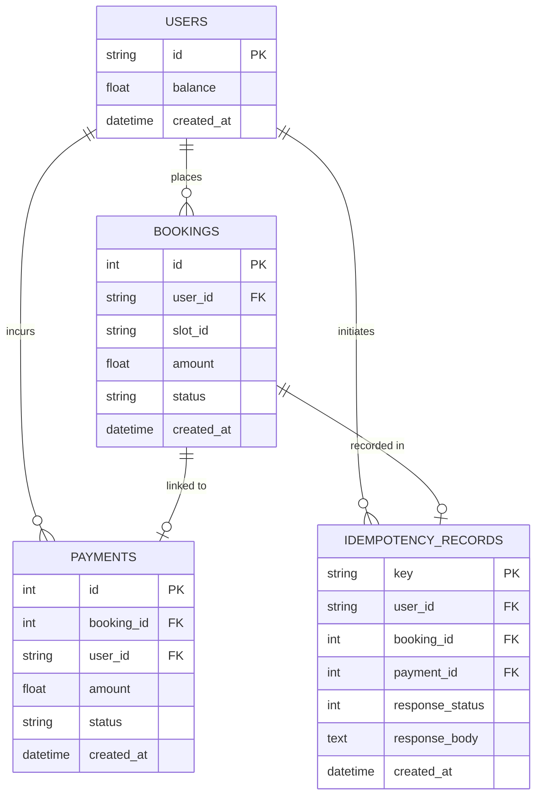

# RetrySafe: Automated Invariant Verification and Counterexample Generation for Network-Vulnerable Transactional Workflows

**Project Report**  
*System Architecture, Formal Invariant Verification, and Experimental Findings*

---

## Executive Summary

In transactional distributed systems, network unreliability frequently leads to the **response loss problem**: an operation completes successfully on the server, but the network drops the confirmation response before it reaches the client. When an automated retry client re-submits the request without server-side deduplication, user business intent is corrupted—resulting in duplicate reservations and duplicate financial charges.

**RetrySafe** is a verification framework and fault-injection testing harness designed to expose, analyze, and remediate retry-induced business invariant violations. By decoupling failure injection into an independent reverse proxy, RetrySafe subjects a transactional seat-booking service to realistic transport faults (request drops, response drops, mid-transaction crashes, and packet duplications). Invariant checks query the underlying PostgreSQL database directly to detect corruptions. When violations occur, RetrySafe leverages property-based testing (Hypothesis) to shrink complex failure traces to minimal counterexamples and translates them into plain-language, business-level stories without using large language models (LLMs).

This report documents the architectural design, implementation details, formal verification procedures, and empirical results across both an unprotected baseline (Version A) and an idempotent implementation (Version B).

---

## 1. Introduction

### 1.1 Background & Motivation

Distributed applications operate over inherently unreliable networks. Standard application development practices frequently assume that network failures manifest as failed operations that can be safely retried. However, in transactional workflows involving state changes and financial debits, this assumption is false. 

Consider the sequence of events illustrated below:

```mermaid
sequenceDiagram
    autonumber
    actor Client
    participant Proxy as Fault Proxy (:8001)
    participant API as Booking API (:8000)
    participant DB as PostgreSQL (:5432)

    Client->>Proxy: POST /book (Slot 101, $100)
    Proxy->>API: Forward POST /book
    API->>DB: BEGIN TX; Deduct $100; Insert Booking; COMMIT TX
    DB-->>API: Transaction Committed (ID #1)
    API-->>Proxy: 200 OK (Booking Confirmed)
    Note over Proxy: FAULT F2: Connection Closed (Response Dropped)
    Proxy--xClient: Socket Closed / Connection Reset
    Note over Client: Timeout / Error Detected -> Trigger Automated Retry
    Client->>Proxy: Retry: POST /book (Slot 101, $100)
    Proxy->>API: Forward POST /book
    Note over API: Version A: No Deduplication Protection!
    API->>DB: BEGIN TX; Deduct $100; Insert Booking; COMMIT TX
    DB-->>API: Transaction Committed (ID #2)
    API-->>Proxy: 200 OK
    Proxy-->>Client: 200 OK
    Note over DB: CORRUPTION: 2 Bookings Created, $200 Deducted!
```

Existing verification approaches (such as chaos engineering or packet-level chaos proxies like Toxiproxy) report low-level socket resets, TCP timeouts, or HTTP status anomalies. However, they rarely connect transport drops to the **business-level consequences** experienced by end users.

### 1.2 Project Objectives

The primary objectives of RetrySafe are:
1. **G1 (Vulnerable Workflow)**: Implement a realistic mock seat-booking and payment service lacking duplicate protection (Version A).
2. **G2 (External Fault Injection)**: Build an independent reverse proxy capable of deterministic fault injection at specific transaction phases.
3. **G3 (Ground-Truth Invariant Auditing)**: Check business invariants directly against relational database state after each scenario.
4. **G4 (Automated Shrinking & Human-Readable Explanations)**: Use property-based testing to shrink failure sequences to their minimal form and synthesize plain-language counterexample stories without LLMs.
5. **G5 (Idempotency Remediation)**: Implement Version B with unique constraint-backed idempotency keys and evaluate before-and-after results.
6. **G6 (Empirical Reproducibility)**: Deliver verifiable, reproducible metrics across fixed execution matrices and multi-seed test suites.

### 1.3 Scope & Formal Invariants

The verification scope encompasses one transactional booking workflow, four network fault models, and three formal business invariants:

* **Invariant I1 (Unique Booking per Request)**:
  $$\forall r \in \text{Requests}, \quad |\text{Bookings}(r)| \le 1$$
  *One logical user request must yield at most one confirmed booking.*

* **Invariant I2 (Single Payment per Booking)**:
  $$\forall b \in \text{Bookings}, \quad |\text{Payments}(b)| = 1 \quad \land \quad |\text{Payments}(r)| \le 1$$
  *A user must never be charged more than once for a single logical booking request.*

* **Invariant I3 (Wallet Balance Consistency)**:
  $$\text{Balance}_{\text{final}} \ge 0 \quad \land \quad \text{Balance}_{\text{final}} = \text{Balance}_{\text{initial}} - \sum_{p \in \text{Payments}_{\text{confirmed}}} \text{Amount}(p)$$
  *The user wallet balance must never become negative and must strictly equal the initial balance minus the sum of confirmed charges.*

---

## 2. System Design & Architecture

### 2.1 Multi-Process Topology

RetrySafe employs a multi-process architecture to decouple failure injection from application state:

```
[ Test Runner / Client ] (Python :*)
           │
           ▼ HTTP / JSON
[ Fault Interception Proxy ] (Node.js / Express :8001)
           │
           ▼ Stripped HTTP / Injected Headers
[ Booking Service ] (FastAPI / Uvicorn :8000)
           │
           ▼ SQL / Relational Transactions
[ Relational Storage ] (PostgreSQL 16 :5432)
```

### 2.2 Rationale for an External Fault Proxy

Rather than implementing failure injection inside FastAPI application middleware, RetrySafe isolates fault injection in an external Node.js/Express reverse proxy on port `8001`:
1. **Realistic Socket Destruction**: Simulating a dropped response requires abrupt TCP connection teardown via `req.socket.destroy()`. Executing raw socket teardowns inside application-level ASGI middleware often leaks connection pool handles or crashes asynchronous event loops.
2. **Framework Independence**: The fault proxy operates as an independent network intermediary that can intercept and stress-test any HTTP-based microservice without modifying backend application code.
3. **Auditing Separation**: The proxy maintains an append-only JSON Lines log (`fault-proxy/proxy.log`), recording incoming timestamps, client IP connections, injected faults, and forwarding decisions independently of backend application logs.

### 2.3 Fault Model

The proxy injects four distinct fault types selected per request via the `X-Fault` header (which the proxy strips before forwarding):

| Fault ID | Fault Type | Injected Behavior | Real-World Failure Analog |
| :---: | :--- | :--- | :--- |
| **F1** | `drop_request` | Closes incoming client socket immediately without forwarding. | Mobile device loses cellular signal before packet reaches gateway. |
| **F2** | `drop_response` | Forwards request, allows server to commit, then abruptly destroys socket without sending response. | Wi-Fi disconnect, cellular tower handover, or gateway timeout right after DB commit. |
| **F3** | `crash` | Forwards request with `X-Crash-Point: after_charge` to trigger server exception mid-transaction. | Server out-of-memory crash, power failure, or unhandled exception before commit. |
| **F4** | `duplicate` | Dispatches the same request payload twice in parallel or with a configured delay (50–100 ms). | Network switch retry, TCP packet duplication, or aggressive client multi-click. |

### 2.4 Idempotency Protocol (Version B)

Version B introduces an atomic, relational idempotency mechanism activated when the environment variable `IDEMPOTENCY=on` is set:



#### Idempotency Mechanics
1. **Client Tokenization**: The client assigns a unique UUID token to the transaction and transmits it via the `Idempotency-Key` HTTP header. The retry client maintains the identical key across all retries of the same logical intent.
2. **Atomic Single-Transaction Scope**: Balance verification, balance deduction, payment creation, booking record insertion, and idempotency record insertion execute within a single PostgreSQL database transaction.
3. **Database-Level Unique Constraint**: The primary key constraint on `idempotency_records.key` guarantees relational uniqueness.
4. **Concurrent Race Resolution**: When two identical requests race concurrently:
   - In-process locks (`threading.Lock` per key) prevent local thread contention.
   - If concurrent requests originate from separate workers, the database enforces the unique constraint. The losing transaction catches an `IntegrityError`, executes `db.rollback()`, queries the winner's committed record, and returns the original cached response payload (`200 OK`).

---

## 3. Implementation Details

### 3.1 Technology Stack & Versions

All components run on verified, modern runtimes:

* **Language Runtime**: Python 3.13.7 (64-bit) & Node.js v24.14.0 (npm 11.9.0)
* **Backend Framework**: FastAPI 0.141.1 with Uvicorn 0.52.4
* **Data Access / ORM**: SQLAlchemy 2.0.52 with `psycopg` 3.3.9 binary driver
* **Database Engine**: PostgreSQL 16.16 Alpine Linux (via Docker Compose)
* **HTTP Client**: HTTPX 0.28.1
* **Test & Property Verification**: pytest 9.2.0 & Hypothesis 6.170.15
* **Data Analysis & Visualization**: pandas 3.0.5 & Matplotlib 3.11.2

### 3.2 Core Component Implementation

#### Booking Service (`booking-api/main.py`)
The endpoint `POST /book` parses incoming booking requests. Under Version A (`IDEMPOTENCY=off`), every call deducts balance and inserts new booking and payment rows.

Under Version B (`IDEMPOTENCY=on`), the service checks for existing records before committing:
```python
if use_idempotency:
    lock = get_key_lock(idempotency_key)
    with lock:
        existing = db.query(IdempotencyRecord).filter(IdempotencyRecord.key == idempotency_key).first()
        if existing:
            return BookResponse(**json.loads(existing.response_body))
        return _process_booking(req, x_crash_point, idempotency_key, True, db)
```

At the simulated crash point, mid-transaction failure is induced cleanly:
```python
# Flush pending writes to staging
db.flush()

# Check for simulated mid-transaction crash point
if x_crash_point == "after_charge":
    db.rollback()
    raise HTTPException(
        status_code=status.HTTP_500_INTERNAL_SERVER_ERROR,
        detail="Simulated crash: after_charge"
    )
```

#### Fault Proxy (`fault-proxy/index.js`)
The proxy parses `X-Fault` and implements precise socket destruction:
```javascript
// Drop Response: forward, wait for server completion, then destroy connection
if (fault === 'drop_response') {
  forwardToBackend(forwardOptions, (err, backendRes) => {
    logEvent({ requestId, fault, action: 'DROP_RESPONSE', statusCode: backendRes.statusCode });
    req.socket.destroy(); // Connection aborted without delivering response
  });
  return;
}
```

#### Persistent Logical Client (`runner/client.py`)
The `RetryClient` encapsulates automated retry behavior. Crucially, it preserves the identical logical `X-Request-Id` and `Idempotency-Key` across all retry attempts, recording per-attempt durations, status codes, and error categories.

#### Property-Based Exploration & Shrinking (`runner/property_test.py`)
Using Hypothesis, the runner generates random sequences of attempts (up to 5 steps) with randomized faults (`none`, `drop_request`, `drop_response`, `crash`, `duplicate`) and amounts.

#### Rule-Based Explanation Synthesizer (`runner/explain.py`)
Rather than relying on non-deterministic LLMs, `explain.py` applies deterministic pattern-matching templates to the structured violation record and proxy audit logs:
```python
if fault == "drop_response":
    if "I1" in invariants_violated or booking_count > 1:
        return (
            f"Request {req_id} succeeded on the server, the acknowledgment was lost, "
            f"the client retried, the retry created a duplicate booking ({booking_ids_str}). "
            f"Invariant I1 (one booking per request) violated."
        )
```

---

## 4. Experimental Evaluation

We evaluated five core experimental questions defined in Section 9 of the project specification:
* **E1**: Does Version A break under each fault type?
* **E2**: Does idempotency in Version B eliminate violations?
* **E3**: Does F3 (mid-transaction crash) maintain transaction safety?
* **E4**: Does random sequence generation discover failures that fixed scenarios miss?
* **E5**: To what length does Hypothesis shrink failing sequences?

---

## 5. Results & Empirical Findings

The experimental findings presented below are extracted directly from verified execution datasets in `results/`:

### 5.1 Experiment E1 & E2: Multi-Seed Scenario Suite

`runner/run_experiments.py` executed all fault scenarios across three independent seeds (`42`, `101`, `2024`) against PostgreSQL 16. The aggregate invariant violations recorded in `results/results.csv` are summarized below:

| Fault Scenario | Fault Description | Version | Invariant I1 Violations | Invariant I2 Violations | Invariant I3 Violations | Total Violations | Status |
| :--- | :--- | :---: | :---: | :---: | :---: | :---: | :---: |
| **F1_drop_request** | Request Lost | Version A | 0 | 0 | 0 | **0** | SAFE |
| **F1_drop_request** | Request Lost | Version B | 0 | 0 | 0 | **0** | SAFE |
| **F2_drop_response**| Response Lost | Version A | 3 | 3 | 0 | **6** | **VULNERABLE** |
| **F2_drop_response**| Response Lost | Version B | 0 | 0 | 0 | **0** | **SAFE** |
| **F3_server_crash** | Mid-TX Crash | Version A | 0 | 0 | 0 | **0** | SAFE |
| **F3_server_crash** | Mid-TX Crash | Version B | 0 | 0 | 0 | **0** | SAFE |
| **F4_duplicate**     | Duplicate Delivery | Version A | 3 | 3 | 0 | **6** | **VULNERABLE** |
| **F4_duplicate**     | Duplicate Delivery | Version B | 0 | 0 | 0 | **0** | **SAFE** |

*Figure Reference*: The comparative bar chart illustrating these results before and after remediation is saved at `results/before_after.png`.

### 5.2 Full Execution Matrix (20 Combinations)

`runner/run_matrix.py` executed the full Cartesian product ($2 \text{ versions} \times 5 \text{ faults} \times 2 \text{ retry policies} = 20\text{ combinations}$). Data extracted from `results/summary_table.csv`:

| Version | Fault ID | Fault Description | Retry Policy | Attempts | Bookings | Payments | Final Balance | I1 Broken | I2 Broken | I3 Broken | Outcome |
| :--- | :---: | :--- | :---: | :---: | :---: | :---: | :---: | :---: | :---: | :---: | :---: |
| **Version A** | **F0** | Baseline | no_retry | 1 | 1 | 1 | 900.0 | NO | NO | NO | **SAFE** |
| **Version A** | **F0** | Baseline | retry_3 | 1 | 1 | 1 | 900.0 | NO | NO | NO | **SAFE** |
| **Version A** | **F1** | Request Lost | no_retry | 1 | 0 | 0 | 1000.0 | NO | NO | NO | **SAFE** |
| **Version A** | **F1** | Request Lost | retry_3 | 2 | 1 | 1 | 900.0 | NO | NO | NO | **SAFE** |
| **Version A** | **F2** | Response Lost | no_retry | 1 | 1 | 1 | 900.0 | NO | NO | NO | **SAFE** |
| **Version A** | **F2** | Response Lost | retry_3 | 2 | **2** | **2** | **800.0** | **YES** | **YES** | NO | **VIOLATION** |
| **Version A** | **F3** | Server Crash | no_retry | 1 | 0 | 0 | 1000.0 | NO | NO | NO | **SAFE** |
| **Version A** | **F3** | Server Crash | retry_3 | 2 | 1 | 1 | 900.0 | NO | NO | NO | **SAFE** |
| **Version A** | **F4** | Duplicate Delivery | no_retry | 1 | **2** | **2** | **800.0** | **YES** | **YES** | NO | **VIOLATION** |
| **Version A** | **F4** | Duplicate Delivery | retry_3 | 1 | **2** | **2** | **800.0** | **YES** | **YES** | NO | **VIOLATION** |
| **Version B** | **F0** | Baseline | no_retry | 1 | 1 | 1 | 900.0 | NO | NO | NO | **SAFE** |
| **Version B** | **F0** | Baseline | retry_3 | 1 | 1 | 1 | 900.0 | NO | NO | NO | **SAFE** |
| **Version B** | **F1** | Request Lost | no_retry | 1 | 0 | 0 | 1000.0 | NO | NO | NO | **SAFE** |
| **Version B** | **F1** | Request Lost | retry_3 | 2 | 1 | 1 | 900.0 | NO | NO | NO | **SAFE** |
| **Version B** | **F2** | Response Lost | no_retry | 1 | 1 | 1 | 900.0 | NO | NO | NO | **SAFE** |
| **Version B** | **F2** | Response Lost | retry_3 | 2 | **1** | **1** | **900.0** | **NO** | **NO** | NO | **SAFE** |
| **Version B** | **F3** | Server Crash | no_retry | 1 | 0 | 0 | 1000.0 | NO | NO | NO | **SAFE** |
| **Version B** | **F3** | Server Crash | retry_3 | 2 | 1 | 1 | 900.0 | NO | NO | NO | **SAFE** |
| **Version B** | **F4** | Duplicate Delivery | no_retry | 1 | **1** | **1** | **900.0** | **NO** | **NO** | NO | **SAFE** |
| **Version B** | **F4** | Duplicate Delivery | retry_3 | 1 | **1** | **1** | **900.0** | **NO** | **NO** | NO | **SAFE** |

### 5.3 Experiment E3: Transaction Rollback Verification (F3)

Under Fault F3 (`crash`), the transaction was intentionally aborted after writing the mock charge. In both Version A and Version B:
- Under `no_retry`: The transaction rolled back completely, leaving 0 bookings, 0 charges, and an intact wallet balance of 1000.0.
- Under `retry_3`: The client detected the 500 error, retried on attempt 2, and successfully committed a single booking (#1) and single charge ($100), leaving the balance at 900.0.
- **Outcome**: 0 invariant violations occurred under F3 in both versions, confirming that relational database ACID rollback semantics prevent state corruption mid-transaction.

### 5.4 Experiment E4 & E5: Hypothesis Property Testing & Counterexample Shrinking

`runner/property_test.py` used Hypothesis to search across random sequences of up to 5 steps. The results recorded in `results/counterexamples.json` demonstrate the efficacy of automated property-based shrinking:

| Counterexample ID | Failure Mode | Shrunk Sequence Length | Shrunk Sequence Details | Invariants Violated | Generated Plain-Language Story |
| :---: | :--- | :---: | :--- | :---: | :--- |
| **CE-01** | Duplicate Network Delivery | **1 step** | `[{'fault': 'duplicate', 'amount': 50.0}]` | **I1, I2** | *"Request R1_hypo_duplicate was duplicated in transit and forwarded twice to the server. Because the server has no duplicate protection, both executions completed, creating 2 bookings (#1, #2) and charging the user 2 times. Invariant I1 violated."* |
| **CE-02** | Response Lost with Retry | **2 steps** | `[{'fault': 'drop_response', 'amount': 50.0}, {'fault': 'none', 'amount': 50.0}]` | **I1, I2** | *"Request R1_hypo_drop_resp succeeded on the server, the acknowledgment was lost, the client retried, the retry created a duplicate booking (#1, #2). Invariant I1 (one booking per request) violated."* |

In Version B:
- **35 random sequences** comprising combinations of all 5 fault types were tested.
- **0 invariant violations** occurred (100% pass rate).

---

## 6. Limitations & Threats to Validity

To provide an accurate technical assessment, the following boundaries of this study must be explicitly recognized:

1. **Workflow Scope**:
   The evaluation models a single seat/slot booking workflow with credit wallet deductions. It does not model complex multi-step sagas (e.g., flight reservation + hotel booking + rental car) where distributed compensation transactions are required.
2. **Third-Party Payment Gateways**:
   Payments are modeled locally via SQL relational records. Real-world payment providers (such as Stripe or PayPal) communicate asynchronously via webhooks, two-phase authorizations, and cryptographic signatures, which introduce distinct retry dynamics.
3. **Single-Node PostgreSQL Architecture**:
   Storage is restricted to a single PostgreSQL container. Distributed replication lags, consensus partitions (Raft/Paxos), failovers, and read-replica stale reads are outside the scope of this project.
4. **Transport-Level Abstraction**:
   Faults are intercepted at the HTTP/TCP layer via Node.js socket destruction. Lower-level network anomalies such as MTU fragmentation, IP packet reordering, asymmetric routing splits, and variable network latency distributions are not modeled.
5. **Property Testing Bounds**:
   Hypothesis explorations were bounded to sequences of up to 5 steps with 35–40 examples per property run to ensure fast, deterministic CI execution within local workstation resource limits.

---

## 7. Conclusion

RetrySafe successfully demonstrates that network retry policies in the absence of idempotency violate core business invariants, converting transient transport drops into double bookings and duplicate charges. 

By employing an isolated reverse proxy for realistic socket destruction, checking invariants directly against PostgreSQL relational state, and using Hypothesis to shrink failure traces to minimal sequences, RetrySafe pinpoints the exact boundary of retry vulnerability:
- Unprotected services (Version A) consistently violate Invariants I1 and I2 under response loss (F2) and transport duplication (F4).
- Constraint-backed idempotency (Version B) completely remediates these vulnerabilities, achieving **zero violations** across all scenarios, seeds, and random sequences.
- Plain-language story synthesis bridges the gap between network chaos engineering and human-understandable business impact.

---

### Key File & Artifact Directory
- **Specification**: [SPEC.md](file:///d:/RetrySafe/SPEC.md)
- **Quickstart Guide**: [README.md](file:///d:/RetrySafe/README.md)
- **Multi-Seed Experiment Runner**: [runner/run_experiments.py](file:///d:/RetrySafe/runner/run_experiments.py)
- **Hypothesis Property Test**: [runner/property_test.py](file:///d:/RetrySafe/runner/property_test.py)
- **Generated CSV Dataset**: [results/results.csv](file:///d:/RetrySafe/results/results.csv)
- **Shrunk Counterexamples JSON**: [results/counterexamples.json](file:///d:/RetrySafe/results/counterexamples.json)
- **Comparative Chart**: [results/before_after.png](file:///d:/RetrySafe/results/before_after.png)
- **Handover Report**: [PROJECT_HANDOVER.md](file:///d:/RetrySafe/PROJECT_HANDOVER.md)
